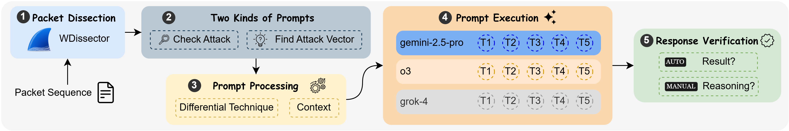

# AirVScan

This repository contains execution code, test cases and specification documents used during AirVScan evaluation. 


*Workflow of AirVScan*


## Test Cases

There are many small files in test cases and we put all our test cases in an archive `captures.7z`.
The structure inside `captures.7z` looks like:
```plain
├───cypress-bt
│   ├───benign
│   │   ├───t1
│   └───mut
│       ├───1-field
│       │   └───t1
│       │       └───prompts
│       │           ├───check_attack
│       │           │   ├───noise
│       │           │   └───normal
│       │           └───find_attack_vector
│       │               ├───noise
│       │               └───normal
│       └───2-field
│           └───t1
```
The hierarchy is `<tested-device>` > `type of test case (e.g. benign and mut)` > `n-field` > `test case` > `prompts`. The PoC attack codes and logs to generate malicious test cases are included here. Specifically, there are four kinds of captures:
1. `capture_bluetooth.pcapng`: Normal capture without noise, with fuzzed packet information.
2. `capture_bluetooth_noise.pcapng`: Noisy capture with fuzzed packet information. 
3. `capture_bluetooth_no_original.pcapng`: Normal capture without noise and fuzzed information
4. `capture_bluetooth_noise_no_original.pcapng`: Noisy capture without noise and fuzzed information

Note that AirVScan only use captures without fuzzed packet information.

Our Bluetooth and 5G NR attacks are taken from public accessible disclosures such as: [^1] [^2] and 
we generate our test cases by running those attacks using [^1]. 

### Prompts

The prompts used in our evaluation are in `prompts` folder of respective test cases. 
The structure of `prompts` folder is as follows:
```
├───check_attack
│   ├───noise
|   |   ├───full.txt
|   |   ├───diff.txt
|   |   ├───full+context.txt
|   |   └───diff+context.txt
│   └───normal
|       ├───full.txt
|       ├───diff.txt
|       ├───full+context.txt
|       └───diff+context.txt
└───find_attack_vector
│   ├───noise
|   |   ├───full.txt
|   |   ├───diff.txt
|   |   ├───full+context.txt
|   |   └───diff+context.txt
│   └───normal
|       ├───full.txt
|       ├───diff.txt
|       ├───full+context.txt
|       └───diff+context.txt
```

The check attack and find attack vector prompts are stored in respective folders.
The prompts containing normal and noisy sequences are also in different folders. 
The four variant of prompts: full (no differential technique), diff (differential technique), 
full+context (no differential technique, with context), diff+context (differential technique. with context) 
are provide in the innermost folder. 

## Results

The results for Bluetooth, 5G NR and Giraffe are placed in `results/` folder in `CSV` format.

## Specification Documents

There are many small files of protocol specification documents and we put those documents in an archive `documents.7z`.

## Evaluation Code and Files

- `airvscan.py`: main code to run AirVScan
- `crawl_sharetechnote.py`: crawl 5G articles from https://www.sharetechnote.com/
- `constant.example.py`: constants for LLM endpoints and keys, as well as configurations for WDissector[^1]
- `gen_modbus_packets.py`: generate Modbus (Giraffe) packet sequences
- `generate_prompt_modbus.py` and `generate_prompt.py`: generate prompts 
- `init_db.py` and `init.sql`: we store our results in a sqlite database and these two are used to initialize the database. 
- `obfuscate_packets.py` and `replace_modbus_docs.py`: logic of obfuscating Modbus packet sequence.
- `pickle_packets.py`: transform PCAP files to easier data structure. Note that WDissector[^1] environment is needed.
- `rag_import.py`, `rag_init.py` and `rag_utils.py`: document search
- `glossary/`: a simple explanation of packet fields

## Evaluation Setup

For packet dissection, WDissector[^1] environment is needed and related setup documentations can be found in [^1]. AirVScan is written by Python and it is advised to run AirVScan on Python>=3.11.

To run our evaluation, please follow the steps:
1. Install Python dependencies via `pip install -r requirements.txt`
2. Copy `constants.example.py` to `constants.py` and fill the necessary fields such as LLM urls and keys
3. Preparation of test cases: extract `captures.7z` to `captures/` folder.
4. (Optional) Preparation of document database: extract `documents.7z` to `documents/` folder. Then run `rag_init.py` and `rag_import.py` to import documents to Milvus[^3] database. This is optional because we have already prepared prompts with contexts. 
3. Run `python init_db.py` if you run for the first time
4. Change running parameters in `airvscan.py` to match your needs. For example: `RunHelper(db_path, "cypress", "bt", "mut", "1-field", models, num_trial=num_trial, num_thread=num_thread, exp_id=exp_id)` means that running cypress (Bluetooth) mut-1-field test cases. 
5. Launch AirVScan by `python airvscan.py`. The results will be stored in `llm_res_final.sqlite3`. 


[^1]: https://asset-group.github.io/disclosures/5ghoul/
[^2]: https://asset-group.github.io/disclosures/braktooth/
[^3]: https://github.com/milvus-io/pymilvus
